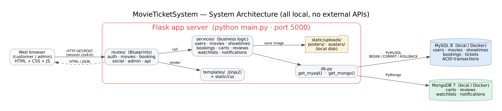
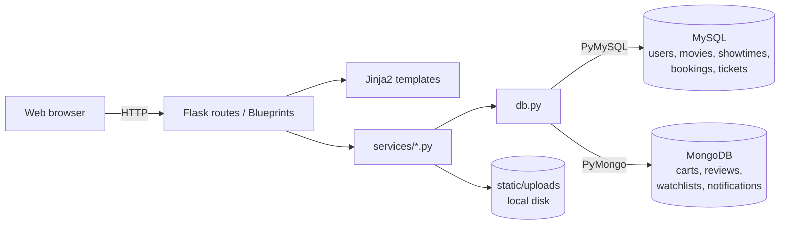
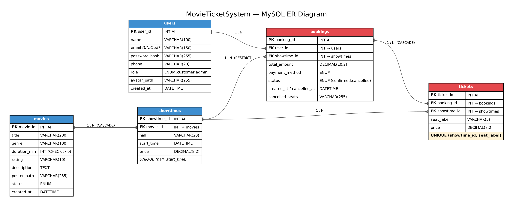
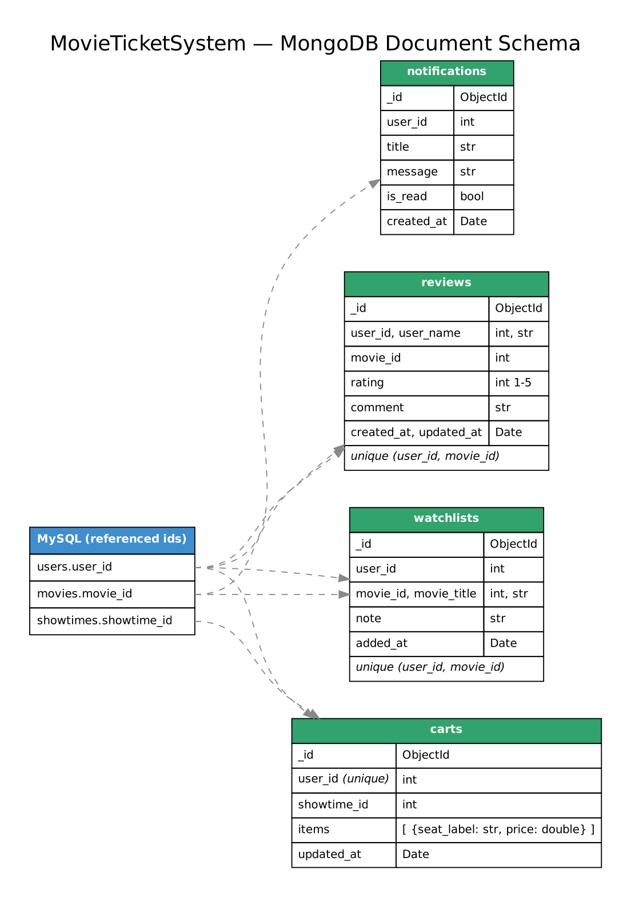
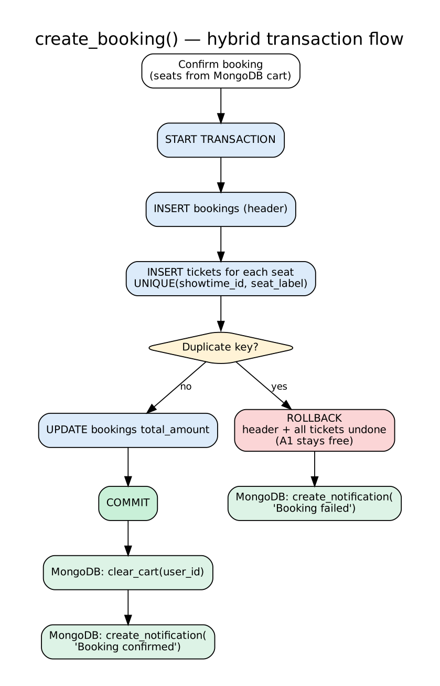
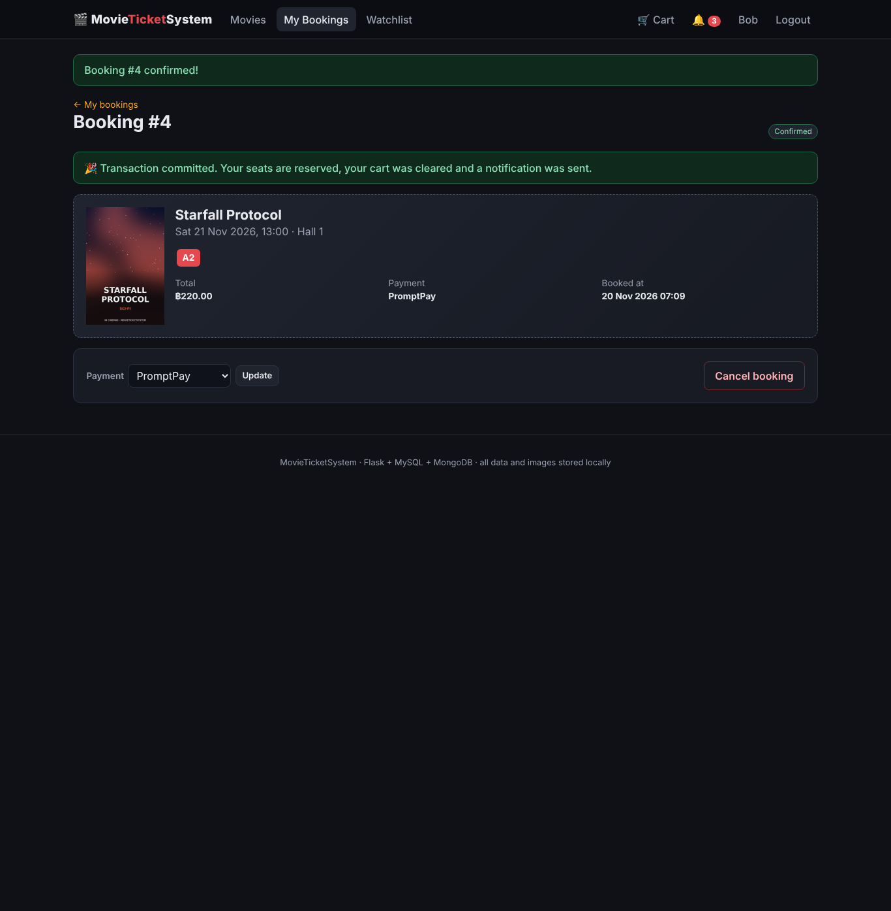
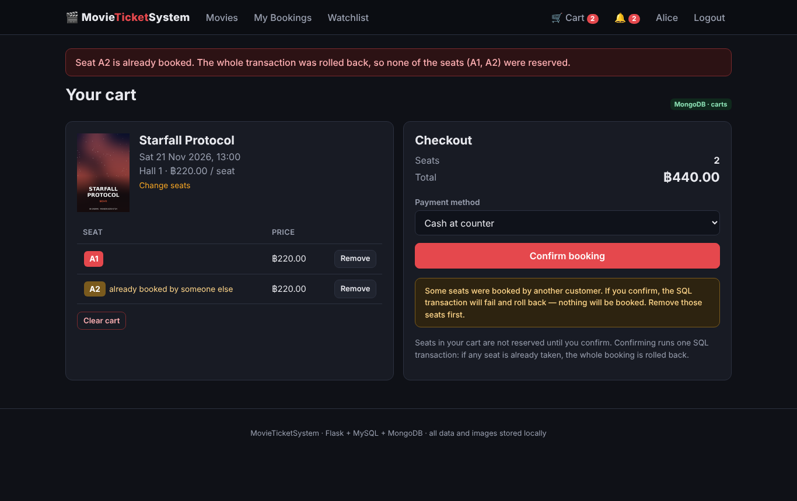
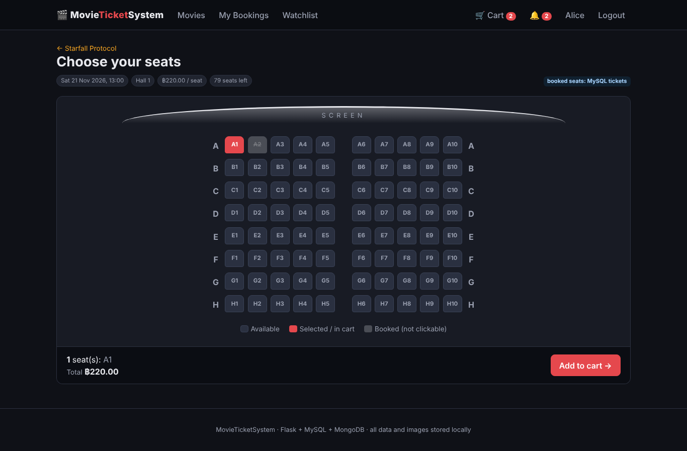
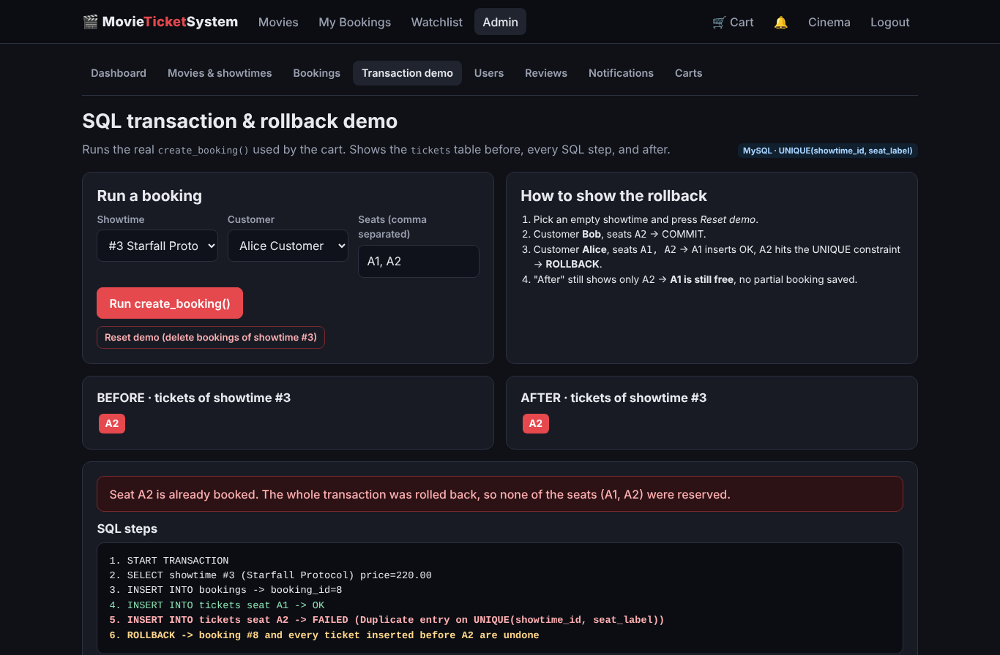

# 🎬 MovieTicketSystem

A cinema booking **web application** with a **hybrid database**: customers browse movies, pick a showtime, choose seats and confirm a booking; admins manage movies, showtimes, bookings and users.

- **MySQL** stores data that must be consistent: `users`, `movies`, `showtimes`, `bookings`, `tickets` (5 related tables, PK/FK, UNIQUE, CHECK, ACID transactions)
- **MongoDB** stores flexible, fast-changing documents: `carts`, `reviews`, `watchlists`, `notifications` (4 collections)
- Everything runs **locally**: local MySQL + MongoDB (Docker), posters and avatars saved on the app server disk, **no external APIs or CDNs**

> 🎥 **Presentation video:** _add YouTube / Drive link here_  
> 📑 **Slides:** _add link here_

---

## 1. Problem and solution

| Problem | How MovieTicketSystem solves it |
|---|---|
| Two customers can try to buy the same seat at the same moment | `tickets` has `UNIQUE (showtime_id, seat_label)`. The database itself refuses a second sale of a seat. |
| A multi-seat booking can fail half-way (A1 saved, A2 taken) | `create_booking()` runs **one SQL transaction**. Any failure → `ROLLBACK`, so no partial booking and A1 stays free. |
| Carts, reviews and notifications change often and have different shapes | They live in **MongoDB** as documents (embedded `items` array, free-text comments, unread flags). |
| Booking must also update the cart and notify the customer | After the SQL `COMMIT`, the app clears the MongoDB cart and inserts a notification (cross-database step). |

---

## 2. Tech stack

| Layer | Technology |
|---|---|
| Frontend | HTML5, Jinja2 templates, one CSS file, a little vanilla JS (seat counter) |
| Backend | Python 3.10+ · Flask 3 (Blueprints) |
| SQL | MySQL 8 · PyMySQL (explicit `BEGIN / COMMIT / ROLLBACK`) |
| NoSQL | MongoDB 7 · PyMongo |
| Passwords | Werkzeug `pbkdf2:sha256` hashes |
| Images | Saved to `static/uploads/posters` and `static/uploads/avatars` |
| Tests | pytest (runs against the real local databases) |

---

## 3. System architecture





---

## 4. Database design

### 4.1 SQL – ER diagram



| Table | Role | Keys / constraints |
|---|---|---|
| `users` | Customer and admin accounts | PK `user_id`, `email` UNIQUE, `role` ENUM |
| `movies` | Catalog | PK `movie_id`, `duration_min` CHECK > 0, `status` ENUM |
| `showtimes` | A movie in a hall at a time | PK, FK `movie_id` → movies (CASCADE), UNIQUE (`hall`, `start_time`) |
| `bookings` | Booking header | PK, FK `user_id` → users, FK `showtime_id` → showtimes (RESTRICT) |
| `tickets` | One row per seat | PK, FK `booking_id` → bookings (CASCADE), FK `showtime_id`, **UNIQUE (`showtime_id`, `seat_label`)** |

Schema: [`database/schema.sql`](database/schema.sql) · Seed: [`database/seed.sql`](database/seed.sql)

### 4.2 NoSQL – document schema



```js
// carts  (one per user, seats for ONE showtime, not reserved until confirm)
{ _id, user_id: 2, showtime_id: 8, items: [ { seat_label: "F5", price: 150.0 } ], updated_at }

// reviews  (unique index user_id + movie_id)
{ _id, user_id: 2, user_name: "Alice Customer", movie_id: 1, rating: 5, comment: "...", created_at, updated_at }

// watchlists  (unique index user_id + movie_id)
{ _id, user_id: 2, movie_id: 6, movie_title: "Coffee & Code", note: "...", added_at }

// notifications
{ _id, user_id: 2, title: "Booking confirmed #7", message: "...", is_read: false, created_at }
```

Seed: [`database/seed_mongo.py`](database/seed_mongo.py) · Indexes are created automatically in `db.ensure_mongo_indexes()`.

---

## 5. CRUD coverage (all through the web UI)

| Entity | Create | Read | Update | Delete |
|---|---|---|---|---|
| **users** (SQL) | Register | Profile, Admin › Users | Edit profile, change password, avatar, admin edits role | Delete account, Admin delete |
| **movies** (SQL) | Admin › Movies (+ poster upload) | Movie list / detail | Admin edit, replace poster | Admin delete (blocked if it has bookings) |
| **showtimes** (SQL) | Admin › Movies › Showtimes | Movie detail (grouped by day), Admin list | Admin edit (only price once tickets are sold) | Admin delete (blocked if it has bookings) |
| **bookings** (SQL) | Cart › Confirm (transaction) | My Bookings, Admin › Bookings (JOINs) | Change payment method, Cancel (transaction) | Admin delete (transaction) |
| **tickets** (SQL) | Created inside the booking transaction | Seat map, booking detail | Released on cancel | Deleted with booking |
| **carts** (Mongo) | Seat map › Add to cart | Cart page, Admin › Carts | Remove a seat / change seats | Clear cart (and auto-clear after booking) |
| **reviews** (Mongo) | Movie detail › Post review | Movie detail (+ average via aggregation), Admin › Reviews | Edit my review | Delete my review, Admin moderation |
| **watchlists** (Mongo) | Movie detail › Add | Watchlist page | Edit note | Remove |
| **notifications** (Mongo) | Auto after booking/cancel/failure, Admin › Send | Notifications page, unread badge | Mark as read / all read | Delete |

---

## 6. Transactions

### 6.1 Booking (SQL transaction + rollback) – `services/bookings.py › create_booking()`



```
START TRANSACTION
  SELECT showtime ... LOCK IN SHARE MODE
  INSERT INTO bookings ...                      -> booking_id
  INSERT INTO tickets (A1)  OK
  INSERT INTO tickets (A2)  Duplicate entry on UNIQUE(showtime_id, seat_label)
ROLLBACK                                        -> booking header + A1 undone
```

On success: `UPDATE bookings total → COMMIT → clear_cart() (Mongo) → create_notification() (Mongo)`.  
On failure: `ROLLBACK → create_notification("Booking failed")` and the page shows the error message.

### 6.2 Cancel booking – `cancel_booking()`
`SELECT ... FOR UPDATE` → `DELETE tickets` (frees the seats) → `UPDATE bookings SET status='cancelled'` → `COMMIT` → notification.

### 6.3 How to show the rollback (for the video / screenshots)
- **In the browser (two users):** Alice adds A1 + A2 to her cart → Bob (another browser / incognito) books A2 → Alice clicks *Confirm booking* → red "rolled back" message, and the seat map still shows A1 free.
- **Admin › Transaction demo:** runs the same function and shows *tickets before*, every SQL step, and *tickets after* on one page.
- **Terminal:** `python scripts/demo_rollback.py`

---

## 7. Setup

### 7.1 Requirements
- Python 3.10+
- Docker Desktop (easiest) **or** local MySQL 8 + MongoDB 6/7

### 7.2 Start the databases (Docker)
```bash
docker compose up -d          # MySQL loads schema.sql + seed.sql automatically on first start
```
Reset everything later: `docker compose down -v && docker compose up -d`

<details><summary>Without Docker (MySQL Workbench / XAMPP + MongoDB Community)</summary>

```bash
mysql -u root -p < database/create_user.sql
mysql -u root -p < database/schema.sql
mysql -u root -p < database/seed.sql
# start MongoDB Community Server on 27017
```
</details>

### 7.3 Install and run the app
```bash
python -m venv .venv
# Windows: .venv\Scripts\activate     macOS/Linux: source .venv/bin/activate
pip install -r requirements.txt
cp .env.example .env                  # Windows: copy .env.example .env
python database/seed_mongo.py         # seed the 4 MongoDB collections
python main.py                        # open http://127.0.0.1:5000
```

### 7.4 Environment variables (`.env`)

| Variable | Default | Meaning |
|---|---|---|
| `FLASK_SECRET_KEY` | `change-me...` | Session signing key |
| `FLASK_DEBUG` / `PORT` | `1` / `5000` | Dev server settings |
| `MYSQL_HOST` / `MYSQL_PORT` | `127.0.0.1` / `3306` | MySQL server |
| `MYSQL_USER` / `MYSQL_PASSWORD` | `movie_app` / `movie_pass` | MySQL login (created by docker-compose) |
| `MYSQL_DATABASE` | `movie_ticket_system` | Schema name |
| `MONGO_URI` / `MONGO_DB` | `mongodb://127.0.0.1:27017` / `movie_ticket_system` | Local MongoDB |
| `UPLOAD_FOLDER` / `MAX_UPLOAD_MB` | `static/uploads` / `5` | Local image storage |

### 7.5 Demo accounts

| Role | Email | Password |
|---|---|---|
| Admin | admin@cinema.local | admin123 |
| Customer | alice@example.com | alice123 |
| Customer | bob@example.com | bob123 |

Seeded showtimes are always tomorrow onwards (relative to the day you load the seed). **Showtime #1 has no bookings** so it is ready for the A1 + A2 rollback demo.

### 7.6 Tests
```bash
pytest                 # needs the databases running and seeded
```
- `tests/test_booking.py` – booking success, **rollback (A1 + A2, A2 taken → A1 still free)**, cancel, UNIQUE constraint, invalid seats, payment update/delete
- `tests/test_crud.py` – Create/Read/Update/Delete for every table and collection

---

## 8. Project structure

```
MovieTicketSystem/
├── main.py                  Flask app, session → current_user, filters        (Debut)
├── db.py                    get_mysql(), get_mongo(), indexes, helpers         (Mizt)
├── services/                business logic (every function returns dict / list of dicts, raises ValueError)
│   ├── users.py             (Debut)      ├── bookings.py      (Mizt)
│   ├── movies.py            (Phoom)      ├── carts.py         (Pooh1tap)
│   ├── seats.py             seat layout A-H x 1-10 (Pooh1tap)
│   ├── showtimes.py         (Phoom)      ├── reviews.py       (Verity)
│   ├── uploads.py           local images ├── watchlists.py    (Verity)
│   └── notifications.py     (Verity)
├── routes/                  Flask Blueprints = the "screens"
│   ├── auth.py  movies.py (+ admin movies/showtimes)  booking.py  social.py  admin.py  api.py
├── templates/               Jinja2 pages (auth/, movies/, booking/, social/, admin/)
├── static/css/style.css     single stylesheet
├── static/uploads/          posters/ and avatars/ stored on the server
├── database/                schema.sql, seed.sql, seed_mongo.py, create_user.sql
├── tests/                   pytest                                              (จอมมารปาแปง)
├── scripts/                 demo_rollback.py, take_screenshots.py
├── docs/diagrams/           architecture, ER, NoSQL, booking flow (.dot/.png/.svg)
├── docs/screenshots/        CRUD + transaction proof screenshots
└── docker-compose.yml       local MySQL 8 + MongoDB 7
```

See [`docs/WORK_SPLIT.md`](docs/WORK_SPLIT.md) for who owns what.

---

## 9. Routes and API

### Web pages
| URL | Screen |
|---|---|
| `/` | Movie list (filter by status, search) |
| `/movies/<id>` | Movie detail + showtimes + reviews + watchlist |
| `/showtimes/<id>/seats` | Seat map (booked seats grey, not clickable) |
| `/cart` | Cart + Confirm (calls `create_booking`) |
| `/bookings`, `/bookings/<id>` | My Bookings / ticket (cancel, change payment) |
| `/watchlist`, `/notifications` | Watchlist, notifications (unread badge) |
| `/login`, `/register`, `/profile` | Account |
| `/admin/movies`, `/admin/movies/<id>/showtimes` | Admin movies + showtimes (routes/movies.py) |
| `/admin/...` | dashboard, bookings, transaction-demo, users, reviews, notifications, carts |

### JSON API (`routes/api.py`, uses the login session cookie)
| Method | Endpoint | Description |
|---|---|---|
| GET | `/api/movies?status=&q=` | List movies |
| GET | `/api/movies/<id>` | Movie + upcoming showtimes + rating summary |
| GET | `/api/movies/<id>/reviews` | Reviews of a movie |
| GET | `/api/showtimes/<id>/booked-seats` | Booked seats `[{seat_label, booking_id}]` |
| GET | `/api/me/cart` · `/api/me/bookings` · `/api/me/notifications` | Current user's data |
| POST | `/api/bookings` | Body `{"showtime_id":1,"seats":["A1","A2"],"payment_method":"cash"}` → 201 or 400 `{"error": ...}` |
| POST | `/api/bookings/<id>/cancel` | Cancel own booking |

---

## 10. Screenshots

All screenshots are in [`docs/screenshots/`](docs/screenshots/README.md). Key transaction proof:

| Booking success (COMMIT) | Rollback (A1 + A2, A2 taken) |
|---|---|
|  |  |
| **A1 still free after rollback** | **Admin transaction demo: before / steps / after** |
|  |  |

---

## 11. Notes
- The original work split planned Tkinter, but the requirement is a **web-based** application, so the same file and function names were kept and the Tkinter frames became Flask pages (`App.show_frame(name)` → URL routes, `current_user` → session).
- Cart seats are not reserved; the SQL transaction is the single source of truth at confirm time.
- MongoDB writes happen **after** the SQL commit, so a MongoDB problem can never undo or corrupt a paid booking.
